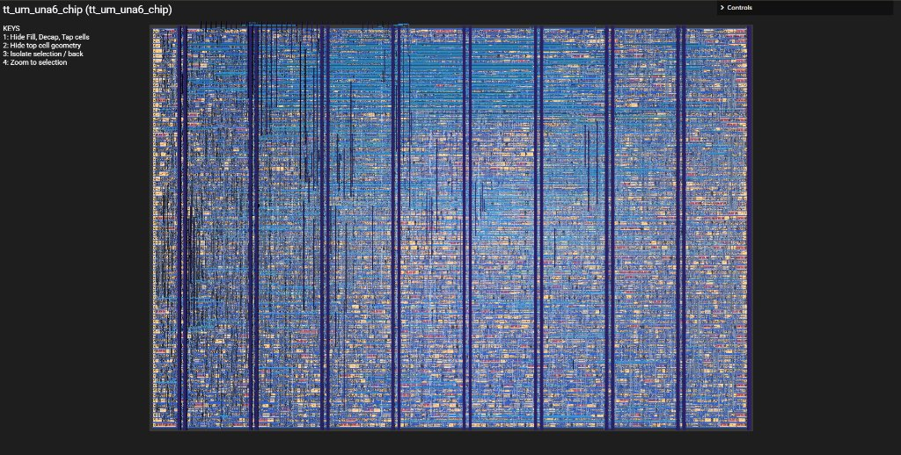

# UNA-6 Custom Microprocessor & Graphics Processing Unit

## Overview
The **UNA-6** is an 8-bit monolithic computing architecture featuring an integrated CPU instruction execution core alongside hardware coprocessors. Designed for real-time calculation and 2D/3D projection, the design integrates dedicated sub-circuits for geometric operations, hardware circle and triangle rasterization, signed 16-bit division, trigonometric calculation, and Bresenham line stepping.

This implementation targets the SkyWater 130nm process through the Tiny Tapeout ASIC flow.

## Architectural Features
- **Central Processing Core:** 8-bit accumulator and register file architecture.
- **Hardware Graphics Accelerator (`GRAPHICSCARD`):** 
  - Coordinate generators with direct X and Y rasterizer stream outputs.
  - Hardware Bresenham line drawing engine (`Bresenham` and `BRESENY`).
  - Triangle and circle geometric rasterization accelerators.
  - 3D to 2D projection and rotation matrix logic (`C3D_TO_2D_RGB`, `ROTATE`).
- **Hardware Math Unit (`MATH`):**
  - Dedicated hardware multiplier and divider (`MULTIPLY`, `DIVISION`).
  - 16-bit signed division engine (`SIGNED_DIVIDER_16`).
  - Trigonometric math lookups (`TRIGCALC`).

## Pinout Configuration

### Primary Inputs (`ui_in[7:0]`)
| Pad | Function | Description |
| :--- | :--- | :--- |
| `ui_in[7:0]` | `INPUT[7:0]` | External 8-bit data / instruction bus input |

### Primary Outputs (`uo_out[7:0]`)
| Pad | Function | Description |
| :--- | :--- | :--- |
| `uo_out[7:0]` | `DATAOUT[7:0]` | CPU accumulator / ALU / graphics result bus |

### Bidirectional Control & Coordinates (`uio_out[7:0]`)
All bidirectional pads are configured as active outputs (`uio_oe = 8'hFF`).
| Pad | Function | Description |
| :--- | :--- | :--- |
| `uio_out[5:0]` | `OUTSIDECONTROL[5:0]` | System bus control strobes, peripheral addressing, status flags |
| `uio_out[6]` | `X` | Direct graphics card rasterizer X coordinate pulse / serial stream |
| `uio_out[7]` | `Y` | Direct graphics card rasterizer Y coordinate pulse / serial stream |

### Timing & Clocks
- `clk`: Master system clock input.
- `rst_n`: Active-low asynchronous reset (inverted internally to active-high for UNA-6 core).
- `ena`: Power and clock gating enable.

## Credits & Acknowledgments
- **Architecture & Circuit Design:** Fulxor & Community (UNA Architecture)
- **ASIC Top-Level Integration & Tiny Tapeout Packaging:** Zeenz123